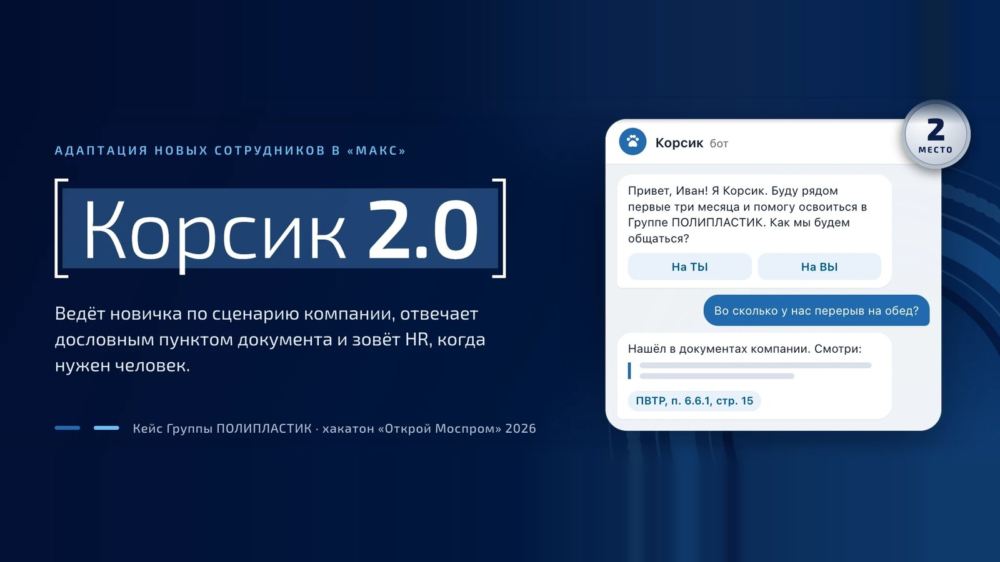
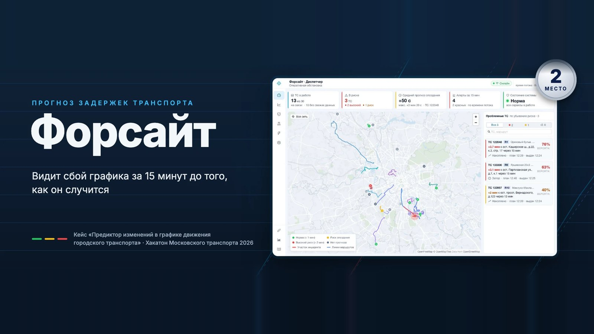
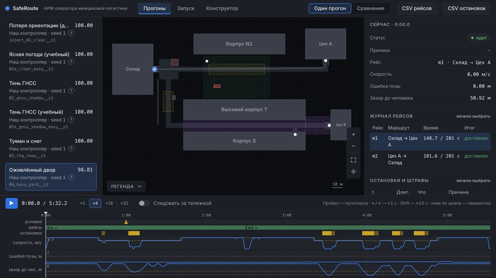
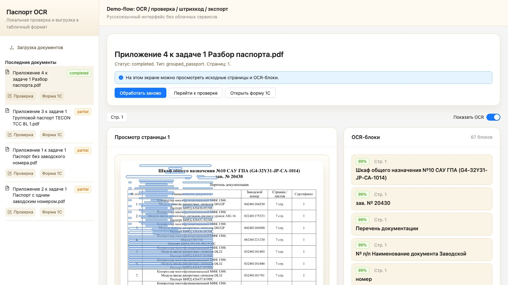

<h1 align="center">Ivan Evstratov</h1>

  DevOps Engineer &nbsp;·&nbsp; Python Backend Background &nbsp;·&nbsp; Moscow

  
  
  

### About

DevOps engineer with a background in Python backend development. I build infrastructure from scratch,
set up CI/CD and container delivery, and keep production stable with monitoring and alerting.

<table>
  <tr><td width="230"><b>Focus</b></td><td>Infrastructure, CI/CD, observability, security</td></tr>
  <tr><td width="230"><b>Background</b></td><td>Python backend: APIs, Telegram bots, AI integrations</td></tr>
  <tr><td width="230"><b>Education</b></td><td>RTU MIREA — Information Systems and Technologies, 2025–2029</td></tr>
  <tr><td width="230"><b>Languages</b></td><td>Russian (native), English (B2)</td></tr>
</table>

### Hackathons

<table>
  <tr>
    <td width="50%" valign="top">
      
      <h4>Otkroi#Mosprom 2026</h4>
      
🏆 <b>2nd place</b> &nbsp;·&nbsp; 25 Oct 2026

      
Onboarding assistant for new Polyplastic Group staff in the MAX messenger. It answers with exact quotes from company documents and cites the source. Anything the documents don't cover goes to HR.

      
<a href="https://github.com/Kurligin/mosprom-polyplast">Code</a> &nbsp;·&nbsp; <a href="https://mosprom-polyplast.rapira-cloud.ru">Demo</a>

    </td>
    <td width="50%" valign="top">
      
      <h4>Moscow Transport Hackathon 2026</h4>
      
🏆 <b>2nd place</b> &nbsp;·&nbsp; 3 Oct 2026

      
Foresight: predicts delays at stops 10–15 minutes ahead from live vehicle telemetry, explains the likely cause and raises alerts on a dispatcher dashboard. Every forecast is later checked against the actual arrival.

      
<a href="https://github.com/DverkuOff/foresight">Code</a> &nbsp;·&nbsp; <a href="https://dverkuoff.github.io/foresight/">Docs</a>

    </td>
  </tr>
  <tr>
    <td width="50%" valign="top">
      
      <h4>CosmoHackathon 2026 · Final</h4>
      
🏆 <b>2nd place</b> &nbsp;·&nbsp; 27 Sep 2026

      
SafeRoute: controller for an autonomous delivery platform that moves cargo between a warehouse, shops and a charger without GNSS, in fog and snow, and around people. Comes with an operator workstation for replaying and comparing runs. Before the final: 2nd place in the Nizhny Novgorod and Krasnoyarsk regional rounds.

    </td>
    <td width="50%" valign="top">
      
      <h4>AI Automation Hackathon 2026</h4>
      
🏆 <b>3rd place</b> &nbsp;·&nbsp; 25 Apr 2026

      
Gazprom Avtomatizatsiya × RTU MIREA. Local digitization of equipment passports: OCR, document type classification, field extraction, export to JSON, CSV and XLSX.

      
<a href="https://github.com/Kurligin/mirea-hac">Code</a>

    </td>
  </tr>
</table>

### DevOps

<table>
  <tr><td width="230"><b>Containers &amp; Orchestration</b></td><td>Docker, Docker Compose, Kubernetes (kubeadm, Gateway API, Envoy Gateway), Harbor</td></tr>
  <tr><td width="230"><b>CI/CD</b></td><td>GitHub Actions, GitLab CI, Gitea with self-hosted runners</td></tr>
  <tr><td width="230"><b>IaC &amp; Automation</b></td><td>Terraform, Ansible, Bash</td></tr>
  <tr><td width="230"><b>Observability</b></td><td>Prometheus, Grafana, alerting, Fluentd, VictoriaLogs</td></tr>
  <tr><td width="230"><b>Networking &amp; Security</b></td><td>Nginx, Traefik, VPN, iptables, TLS/SSL, Vault, Sealed Secrets</td></tr>
  <tr><td width="230"><b>Cloud</b></td><td>Yandex Cloud, VK Cloud, Selectel, S3, bare metal</td></tr>
  <tr><td width="230"><b>Data &amp; Messaging</b></td><td>PostgreSQL, Redis, MongoDB, ClickHouse, Kafka, RabbitMQ</td></tr>
</table>

### Backend

<table>
  <tr><td width="230"><b>Web &amp; API</b></td><td>FastAPI, Pydantic, httpx, Uvicorn</td></tr>
  <tr><td width="230"><b>Bots</b></td><td>aiogram 3, Telethon</td></tr>
  <tr><td width="230"><b>Persistence</b></td><td>SQLAlchemy 2.0 (async), Alembic, asyncpg</td></tr>
  <tr><td width="230"><b>AI Integrations</b></td><td>Anthropic API, LiteLLM, LiveKit Agents</td></tr>
  <tr><td width="230"><b>Code Quality</b></td><td>pytest, Ruff, Black, mypy, pre-commit</td></tr>
  <tr><td width="230"><b>Tooling</b></td><td>uv, Poetry</td></tr>
</table>

Also familiar with TypeScript, React and Swift.
